# CG

Computer Graphics lab programs (Turbo C `graphics.h`). Each program links to its source in [`code`](./code) and shows its output from [`output`](./output).

## Contents

1. [Digital Differential Analyzer Algorithm](#1-digital-differential-analyzer-algorithm)
2. [Bresenham's Line Drawing Algorithm](#2-bresenhams-line-drawing-algorithm)
3. [Midpoint Circle Generation Algorithm](#3-midpoint-circle-generation-algorithm)
4. [Ellipse Generation Algorithm](#4-ellipse-generation-algorithm)
5. [Creating various types of texts and fonts](#5-creating-various-types-of-texts-and-fonts)
6. [Creating two dimensional objects](#6-creating-two-dimensional-objects)
7. [Two Dimensional Transformations](#7-two-dimensional-transformations)
8. [Coloring the Pictures](#8-coloring-the-pictures)
9. [Three Dimensional Transformations](#9-three-dimensional-transformations)
10. [Curve Generation](#10-curve-generation)
11. [Simple Animations using transformations](#11-simple-animations-using-transformations)
12. [Key Frame Animation](#12-key-frame-animation)

## 1. Digital Differential Analyzer Algorithm

[program](./code/01-digital-differential-analyzer-algorithm.c)

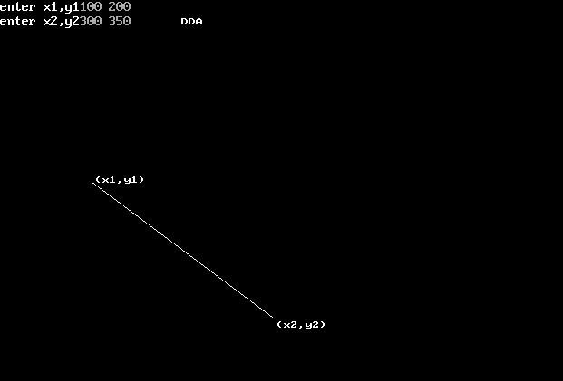

## 2. Bresenham's Line Drawing Algorithm

[program](./code/02-bresenham-line-drawing-algorithm.c)

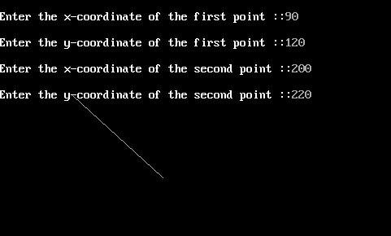

## 3. Midpoint Circle Generation Algorithm

[program](./code/03-midpoint-circle-generation-algorithm.c)

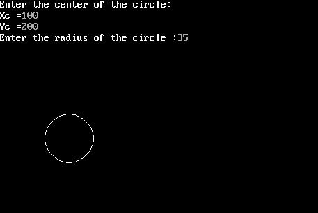

## 4. Ellipse Generation Algorithm

[program](./code/04-ellipse-generation-algorithm.c)

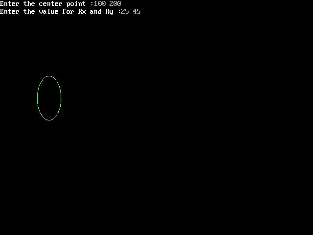

## 5. Creating various types of texts and fonts

[program](./code/05-text-and-fonts.c)

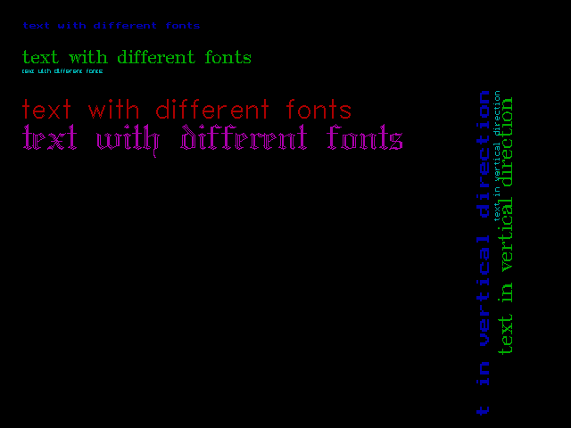

## 6. Creating two dimensional objects

| Object | Program | Output |
| --- | --- | --- |
| House | [program](./code/06-house.c) | 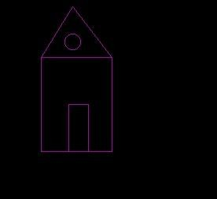 |
| Car | [program](./code/06-car.c) | 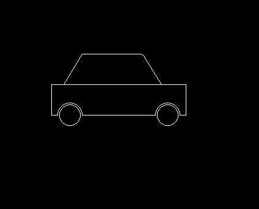 |
| Fish | [program](./code/06-fish.c) | 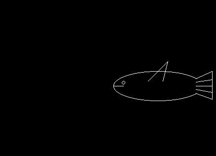 |
| Man | [program](./code/06-man.c) | 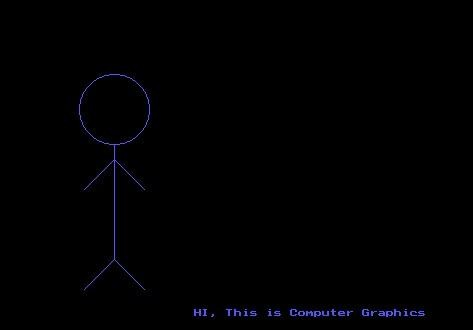 |
| Triangle using `drawpoly()` | [program](./code/06-drawpoly.c) | 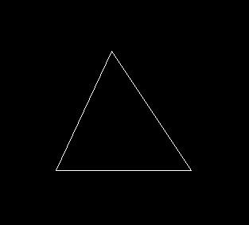 |

## 7. Two Dimensional Transformations

### Translation

[program](./code/07-translation.c)

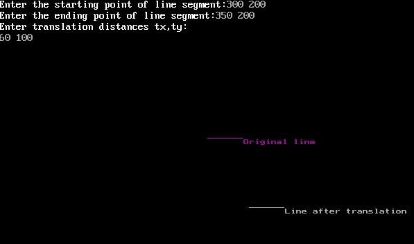

### Scaling

[program](./code/07-scaling.c)

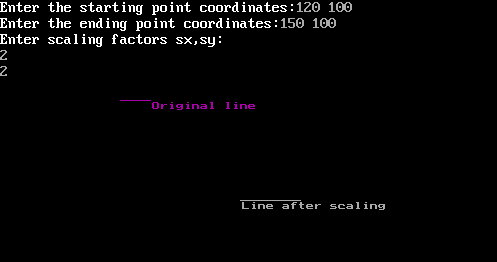

### Rotation

[program](./code/07-rotation.c)

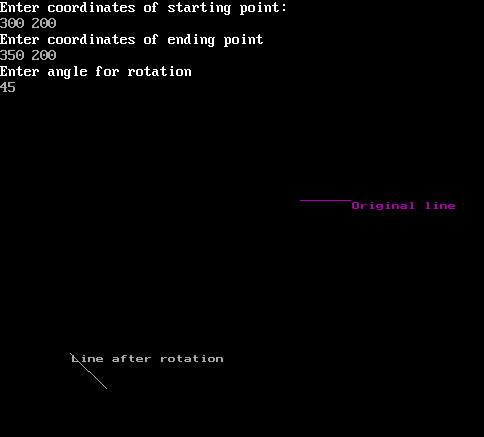

### Reflection about x-axis

[program](./code/07-reflection-x-axis.c)

Before reflection:

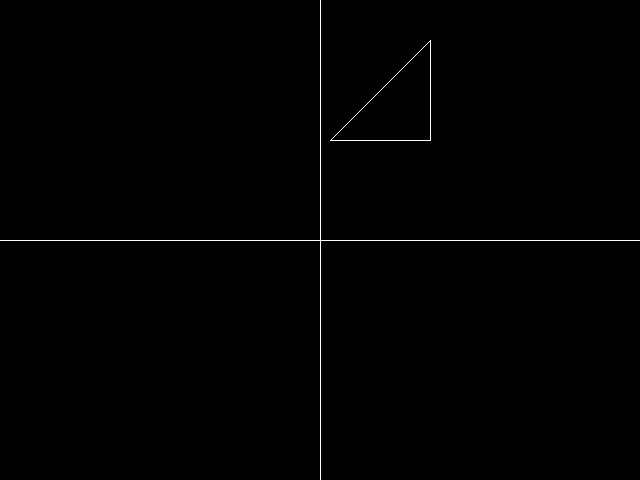

After reflection about x-axis:

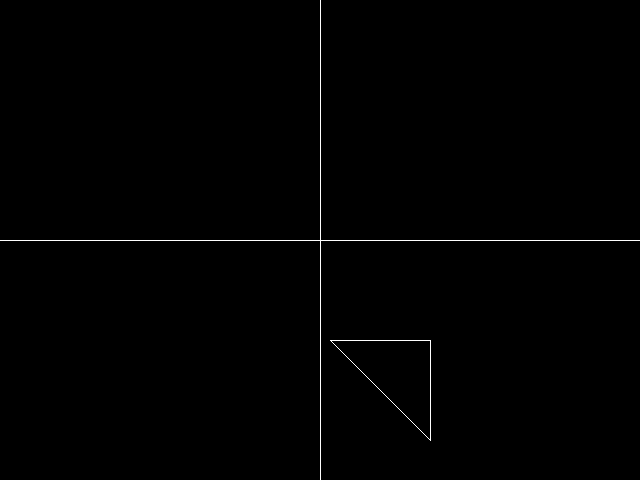

### Reflection about y-axis

[program](./code/07-reflection-y-axis.c)

Before reflection:


After reflection about y-axis:

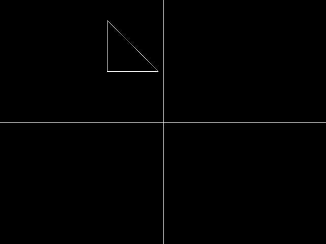

### X-shear

[program](./code/07-x-shear.c)

The red rectangle is the object after x-shear.

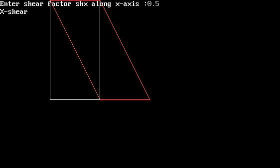

### Y-shear

[program](./code/07-y-shear.c)

The red rectangle is the object after y-shear.

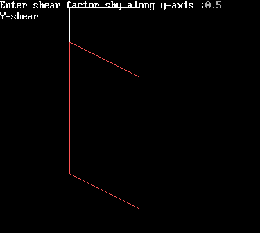

## 8. Coloring the Pictures

### Flood fill

4-connected: [program](./code/08-flood-fill-4-connected.c)

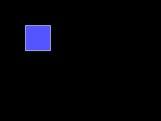

8-connected: [program](./code/08-flood-fill-8-connected.c)

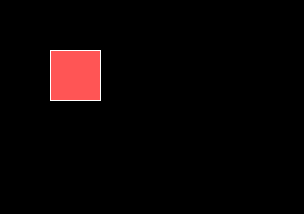

### Boundary fill

4-connected: [program](./code/08-boundary-fill-4-connected.c)

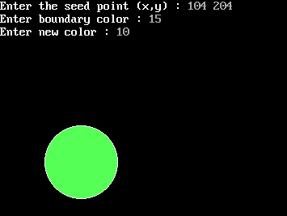

8-connected: [program](./code/08-boundary-fill-8-connected.c)

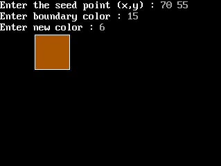

### Scan line polygon fill

[program](./code/08-scan-line-polygon-fill.c)

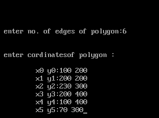 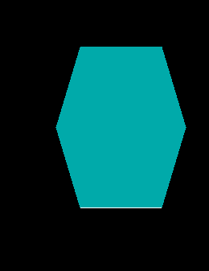

### Using inbuilt graphics functions

| Function | Program | Output |
| --- | --- | --- |
| `fillpoly` | [program](./code/08-fillpoly.c) | 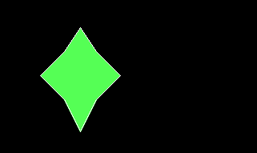 |
| `floodfill` | [program](./code/08-floodfill.c) | 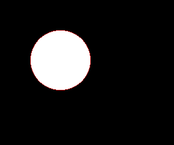 |
| `setfillstyle` | [program](./code/08-setfillstyle.c) | not shown in the manual |
| `setcolor` | [program](./code/08-setcolor.c) | 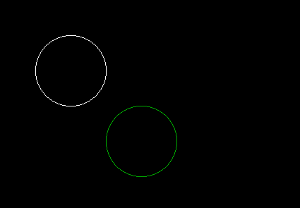 |
| `fillellipse` | [program](./code/08-fillellipse.c) | 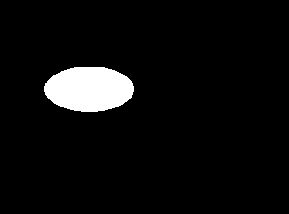 |

## 9. Three Dimensional Transformations

### Translation

[program](./code/09-3d-translation.c)

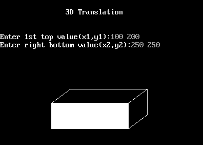 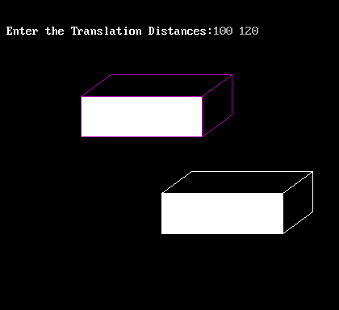

### Scaling

[program](./code/09-3d-scaling.c)

 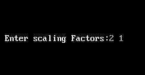 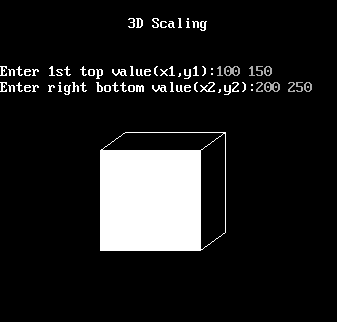  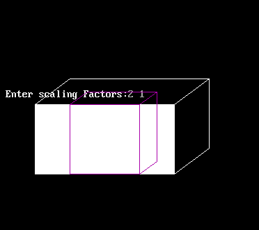

### Rotation

[program](./code/09-3d-rotation.c)

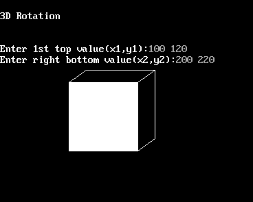 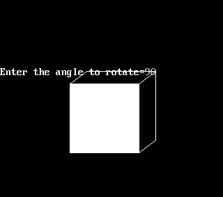

## 10. Curve Generation

Bezier curve: [program](./code/10-bezier-curve.c)

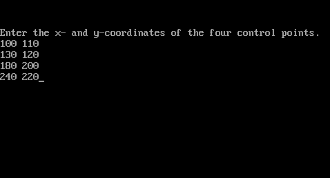 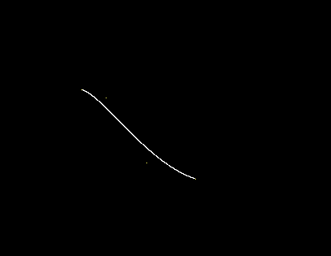

## 11. Simple Animations using transformations

Moving circle in different directions: [program](./code/11-moving-circle.c)

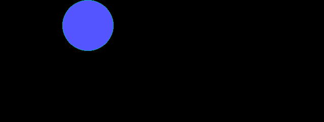 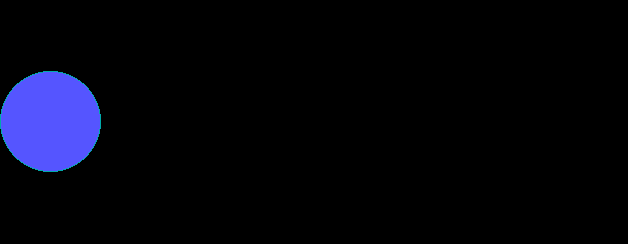 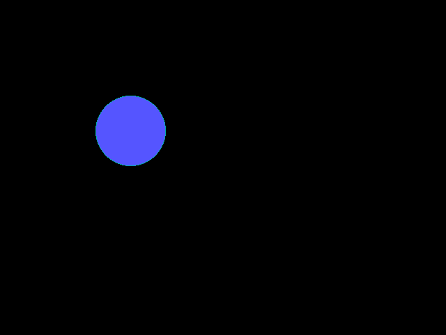 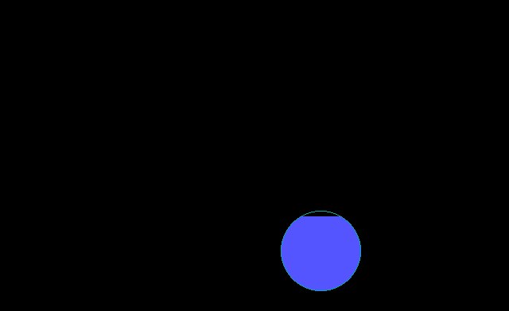

## 12. Key Frame Animation

Done in Adobe Flash Professional (timeline and key frames); there is no C program for this one.

## Running in DOSBox

```
# mount host ~/dosboxx as C: drive
mount c ~/dosboxx

# add turbo c to path
SET PATH=C:\TC\BIN;Z:\;Z:\SYSTEM;Z:\BIN;Z:\DOS

# compile
TC\BIN\TCC.EXE -IC:\TC\INCLUDE -LC:\TC\LIB C:\1.c GRAPHICS.LIB

# run
1.EXE
```
