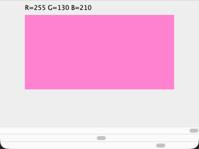
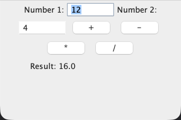

# JAVA

## 1. Operators and Expressions [program](./01/OperatorsExpressions.java)
1. Write a Java program to find the area of a rectangle.
2. Write a Java program to find the result of the following expressions (assume a = 10 and b = 5):
   1. `(a << 2) + (b >> 2)`
   2. `(b > 0)`
   3. `(a + b * 100) / 10`
   4. `a & b`
3. Write a Java program to print the individual digits of a 3-digit number.

## 2. Decision Making Statements [program](./02/DecisionMaking.java)
1. Write a Java program to read two integers and print the larger number followed by the words "is larger". If the numbers are equal, print the message "These numbers are equal".
2. Write a Java program to read an integer and find whether the number is odd or even.
3. Write a Java program to find the biggest of three integers.

## 3. Looping Statements [program](./03/LoopingStatements.java)
1. Write a Java program to find the sum of digits of a given number.
2. Write a Java program to find the first 15 terms of the Fibonacci sequence.
3. Write a Java program to print the Armstrong numbers.

## 4. Classes and Objects
1. To write a Java program to display total marks of 5 students using student class. Given the following attributes: Regno(int), Name(String), Marks in subjects(Integer Array), Total(int). [program](./04/Student.java)
2. To write a program in Java with a class Rectangle with the data fields width, length, area and colour. The length, width and area are of double type and colour is of String type. The methods are get_length(), get_width(), get_colour() and find_area(). [program](./04/Rectangle.java)
    - Create two objects of Rectangle and compare their area and colour. If the area and colour both are the same for the objects then display "Matching Rectangles", otherwise display "Non-matching Rectangle".

## 5. Arrays Basic [program](./05/ArraysBasic.java)
1. Find the Largest and Smallest Element in an Array
2. Perform Matrix Addition

## 6. Inheritance [program](./06/Player.java)
1. Write a Java program to create a Player class and inherit three classes Cricket_Player, Football_Player and Hockey_Player.

## 7. Interfaces 
1. To write a Java program to show how a class implements two interfaces. [program](./07/MultipleInterfaces.java)
2. To write a Java program to show that the variables in an interface are implicitly static and final and methods are automatically public. [program](./07/InterfaceFields.java)

## 8. Exception Handling
1. To write a Java program to catch more than two exceptions. [program](./08/MultipleExceptions.java)
2. To write a Java program to create our own exception subclass that throws an exception if the sum of two integers is greater than 99. [program](./08/CustomException.java)

## 9. Multithreading [program](./09/Multithreading.java)
1. To write a Java program for generating two threads, one for generating even numbers and one for generating odd numbers.

## 10. Strings [program](./10/Strings.java)
1. Write a Java program that creates a String object and initializes it with your name and performs the following operations:
   a. Find the length of the String object using an appropriate String method.
   b. Find whether the character `'a'` is present in the string. If yes, find the number of times `'a'` appears in the name and the location where it appears.

## 11. String Buffer
1. Write a Java program to create a StringBuffer object and illustrate how to append characters and display the capacity and length of the StringBuffer. [program](./11/StringBufferAppend.java)
2. Write a Java program to create a StringBuffer object and illustrate how to insert characters at the beginning. [program](./11/StringBufferInsert.java)
3. Write a Java program to create a StringBuffer object and illustrate the operations of the `append()` and `reverse()` methods. [program](./11/StringBufferReverse.java)

## 12. Packages [BookDetails.java](./12/BookDetails.java) · [books/Book.java](./12/books/Book.java)
1. Write a Java program to create a package for Book details, giving Book name, Author name, Price and Year of publishing.

## 13. Applets & AWT
1. Write a Java applet program to change the colour of a rectangle using scroll bars to change the value of red, green and blue. [program](./13/ColorScroll.java)

   

2. Write an applet program for creating a simple calculator to perform addition, subtraction, multiplication and division using Button, Label and TextField components. [program](./13/Calculator.java)

   
